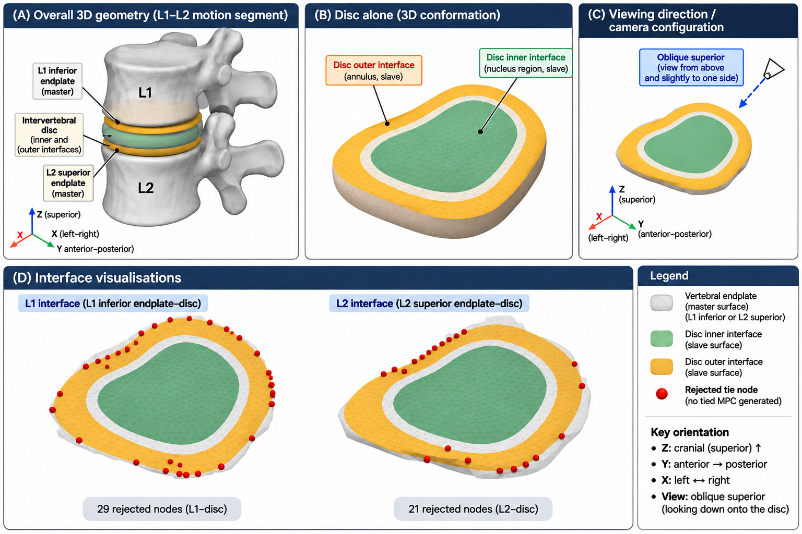
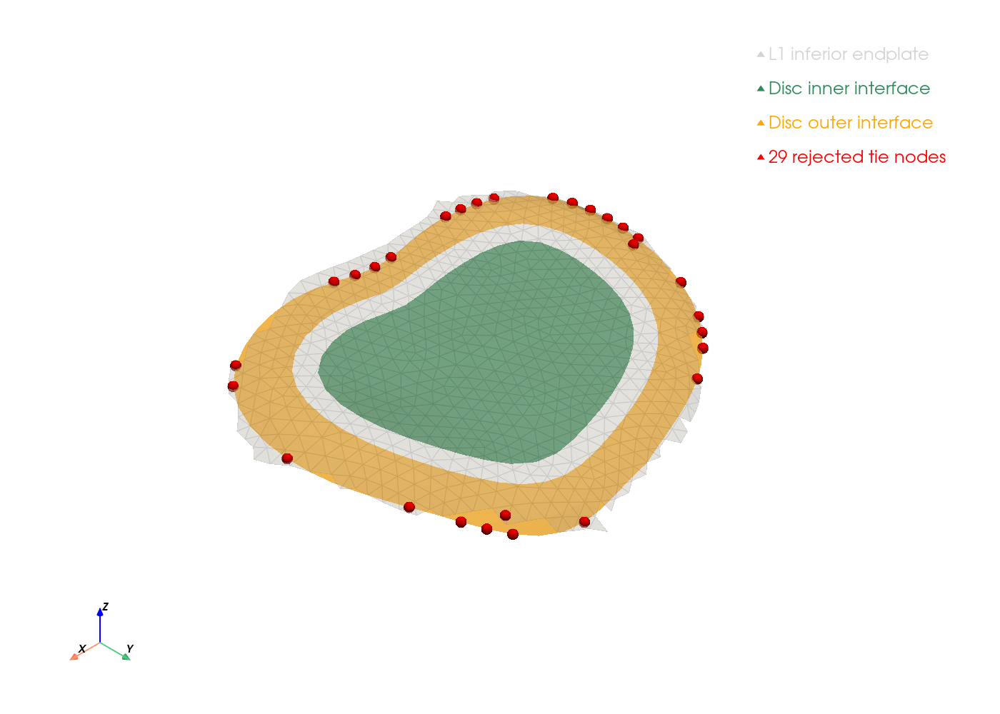
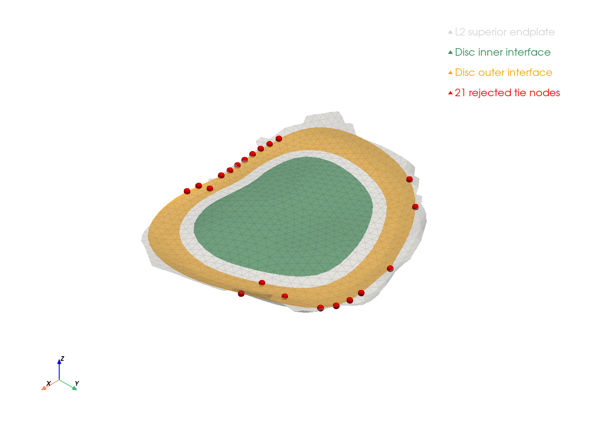

# Spinal Finite Element Analysis (FEA)

**Status:** Work in Progress — Baseline Compression Simulation Completed; Mechanical Validation Ongoing

## Overview

An exploratory computational biomechanics project investigating vertebral loading, mechanical stresses, and spinal stability using finite element analysis (FEA).

The project aims to develop a reproducible workflow integrating medical imaging, anatomical reconstruction, finite element meshing, mechanical simulation, and visualisation.

The longer-term research objective is to investigate the mechanical behaviour of vertebral compression fractures, including stress distribution, deformation and potential contributors to progressive vertebral collapse.

This repository documents the development process, including dataset selection, mesh preparation, computational methods, technical challenges and simulation results.

## Research Objectives

1. Develop a functioning FEA simulation using an existing L1–L2 vertebral model.

2. Reconstruct pathological vertebral anatomy from publicly available CT imaging and investigate compression-fracture biomechanics.

3. Explore longitudinal changes in vertebral morphology, including progressive collapse and kyphotic deformity, subject to suitable serial imaging data being available.

## Current Progress

### Stage 1: Baseline L1–L2 Simulation — Completed (Exploratory)

**Source model:** [L1–L2 finite element model — Zenodo](https://zenodo.org/records/3961334)

The initial stage uses an existing anatomical model containing two lumbar vertebrae and the intervening intervertebral disc.

**Completed:**

- Established the Python and CalculiX computational environment under WSL Ubuntu.
- Downloaded and inspected the original MED-format finite element mesh.
- Identified the anatomical element groups representing L1, L2 and the intervertebral disc.
- Developed a Python script to convert the MED mesh into a CalculiX-compatible input file.
- Preserved the anatomical element sets and superior/inferior boundary node groups.
- Investigated mesh connectivity and geometric proximity between anatomical structures.
- Validated tetrahedral element orientation and corrected inverted connectivity for CalculiX.
- Confirmed positive signed volumes for all 62,247 tetrahedral elements.
- Identified anatomical vertebral endplate and disc-facing surface groups.
- Generated six CalculiX-compatible anatomical surface definitions.
- Visualised the L1, L2 and intervertebral disc regions using ParaView.
- Quantified disc-to-endplate surface distances using triangular surface proximity analysis.

**Mesh characteristics:**

| Component | Count |
|---|---:|
| Nodes | 17,513 |
| Tetrahedral elements | 62,247 |
| L1 elements | 29,430 |
| L2 elements | 28,756 |
| Intervertebral disc elements | 4,061 |
| L1 superior boundary nodes | 815 |
| L2 inferior boundary nodes | 929 |

### Baseline Compression Simulation

A simplified displacement-controlled axial compression simulation was implemented using CalculiX 2.21.

**Model configuration**

| Parameter | Configuration |
|---|---|
| Anatomy | L1, L2 and intervening intervertebral disc |
| Mesh | 17,513 nodes; 62,247 first-order tetrahedral elements |
| Vertebral material | Linear elastic, E = 1000 MPa, ν = 0.30 |
| Disc material | Linear elastic, E = 10 MPa, ν = 0.45 |
| Inferior boundary | L2 inferior surface fixed in X, Y and Z |
| Superior boundary | L1 superior surface prescribed +0.1 mm displacement along Z |
| Interface constraints | Four surface-based CalculiX tie constraints |
| Units | N–mm–MPa |

Two simulations were completed successfully, comparing the default CalculiX tie tolerance with an explicitly specified tolerance of 0.05 mm.

**Preliminary results**

| Measurement | Default tolerance | 0.05 mm tolerance |
|---|---:|---:|
| Untied disc nodes | 228 | 50 |
| Axial reaction force | 397.320 N | 556.540 N |
| Effective axial stiffness | 3973.201 N/mm | 5565.400 N/mm |
| Maximum nodal displacement | 0.133626 mm | 0.132768 mm |
| Maximum nodal von Mises stress | 0.987775 MPa | 1.579123 MPa |

Both simulations demonstrated negligible global axial reaction-force imbalance.

However, increasing the tie tolerance produced a **40.07% increase in calculated axial stiffness**, demonstrating substantial sensitivity to the disc–vertebra interface constraints.

These findings represent numerical verification and sensitivity analysis, not physiological validation.

### Vertebra–Disc Interface Investigation

The original MED mesh contains separate inner and outer disc interface surface families.

Geometric and topological analysis using Python, SciPy, VTK and PyVista established that:

- Inner disc interfaces form connected central surface patches.
- Outer disc interfaces form connected annular surfaces.
- All 50 remaining rejected tie nodes occur on the peripheral annular interface surfaces.
- Ten rejected nodes fall outside the XY-projected vertebral endplate footprints.
- The remaining 40 rejected nodes lie within the projected footprints but exceed the 0.05 mm tie tolerance.

The peripheral mismatches may reflect anatomical geometry, mesh discretisation or imperfect interface alignment. Their mechanical significance remains unresolved.

**Anatomical orientation**

The following schematic illustrates the L1–L2 vertebral bodies, intervening intervertebral disc, and anatomical interfaces relevant to the finite element simulations.



**L1 disc–vertebra interface**



**L2 disc–vertebra interface**



The original mesh geometry has been preserved rather than artificially repositioning peripheral nodes or increasing tie tolerance further.

For detailed methods and limitations, see:

- [Interface methodology](docs/interface_methodology.md)
- [Validation progress](docs/validation_progress.md)
- [Literature references](docs/references.md)

### Current Validation Status

**Completed:** Baseline compression simulations, global force-equilibrium checks, axial stiffness calculation, interface sensitivity comparison, peripheral tie-node visualisation, and original MED interface topology investigation.

**Outstanding:** Displacement and stress-field visualisation, mesh convergence assessment, evaluation of possible volumetric locking, interface refinement where justified, and comparison against appropriate experimental or published biomechanical reference data.

The model is an exploratory computational demonstration and must not be interpreted as a clinically validated prediction of spinal loading or stability.

**Preliminary connectivity findings:**

The L1 vertebra, L2 vertebra and intervertebral disc are represented by separate element groups without shared interface nodes.

Geometric proximity analysis identified closely positioned nodes between the vertebrae and disc, but no exactly coincident nodes.

These findings motivated the use of surface-based tie constraints in the subsequent compression simulations. The resulting load transfer has been numerically investigated, although the interface formulation remains subject to further validation.

**Interface geometry validation:**

Disc-node-to-endplate surface proximity was investigated by measuring distances from disc-facing nodes to the continuous triangular vertebral endplate surfaces.

| Measurement | L1–disc | Disc–L2 |
|---|---:|---:|
| Median distance | 0.00793 | 0.00791 |
| Mean distance | 0.04850 | 0.02637 |
| 95th percentile | 0.18832 | 0.08753 |
| Maximum distance | 1.61073 | 0.65512 |
| Nodes within 0.25 coordinate units | 96.0% | 97.6% |

These measurements indicate close geometric alignment across most of both interfaces, although isolated discrepancies remain. Coordinate units have not yet been independently verified.

The surface definitions were subsequently used in successful CalculiX compression simulations. Global force equilibrium was demonstrated, but the sensitivity of axial stiffness to tie tolerance indicates that interface behaviour remains an important source of numerical uncertainty.

The baseline compression simulations have been completed successfully. However, mechanical verification remains incomplete, and the model has not undergone physiological or experimental validation.

### Stage 2: Patient-Specific Compression Fracture Simulation — Planned

The second stage aims to develop an FEA model from an actual CT examination demonstrating vertebral compression fracture.

**Planned workflow:**

1. Identify a suitable CT scan demonstrating a non-instrumented vertebral compression fracture.
2. Segment the relevant vertebral anatomy.
3. Reconstruct the three-dimensional pathological geometry.
4. Generate a computational mesh.
5. Assign material properties and mechanical boundary conditions.
6. Simulate controlled loading.
7. Investigate stress concentrations, deformation and mechanical behaviour.

This stage will build on the computational workflow developed during the baseline simulation.

### Stage 3: Longitudinal Fracture Analysis — Conditional

If suitable serial CT examinations become available, the project may be extended to investigate progressive vertebral collapse.

Potential analyses include:

- Vertebral height loss.
- Changes in local kyphotic angulation.
- Differences in predicted mechanical stress and deformation.
- Relationships between observed morphological progression and simulated mechanical parameters.

This stage is conditional on identifying suitable longitudinal imaging with reliable patient matching and examination chronology.

## Dataset Investigation

### L1–L2 Finite Element Model

[Zenodo record](https://zenodo.org/records/3961334)

Selected as the initial baseline model because it provides an existing volumetric mesh containing L1, L2 and the intervening disc.

The original MED mesh is retained locally and converted into CalculiX format using the repository's Python conversion script.

### VerSe 2019/2020

[VerSe repository](https://github.com/anjany/verse)

A potential source of vertebral CT imaging and segmentation annotations for subsequent patient-specific modelling.

The availability of suitable, confirmed compression-fracture cases requires further assessment.

### UWSpineCT / BioMedIA

[Dataset source](https://biomedia.doc.ic.ac.uk/data/spine/)

An initial feasibility investigation was undertaken to identify suitable pathological spine CT examinations.

The screening encountered limitations including spinal instrumentation, imaging resolution and uncertainty regarding the availability of suitable serial non-instrumented compression-fracture cases.

The dataset has therefore not been selected for the first patient-specific simulation.

## Repository Structure

```text
spinal-fea/
├── data/               # Local imaging and derived data
├── mesh/               # Finite element mesh files
├── scripts/
│   ├── convert_med_to_calculix.py
│   └── screen_ct_scans.py
└── README.md
```

Additional directories and scripts will be documented as the simulation workflow develops.

Large imaging datasets, downloaded meshes and generated solver outputs are excluded from version control.

## Computational Environment

**Implemented:**

- Python 3.11
- NumPy
- SciPy
- NiBabel
- h5py
- meshio
- CalculiX 2.21
- ParaView 6.0.1
- trimesh
- rtree
- WSL Ubuntu

**Planned or under consideration:**

- Gmsh
- 3D Slicer

## Reproducibility

The baseline mesh originates from the Zenodo record linked above and is not redistributed in this repository.

The conversion script can be executed after obtaining the source MED file:

```bash
python scripts/convert_med_to_calculix.py
```

The script reads `mesh/L1-L2.med` and produces `mesh/L1-L2_calculix.inp`, preserving the principal anatomical element groups and selected boundary node groups.

The generated mesh file contains the anatomical geometry and element sets required for the mechanical model.

CalculiX input files were subsequently developed to define material properties, surface-based tie constraints, boundary conditions and displacement-controlled axial compression.

The completed baseline simulations and associated numerical investigations are documented in:

- [Validation progress](docs/validation_progress.md)
- [Interface methodology](docs/interface_methodology.md)

The original third-party mesh and generated solver result files are not redistributed in this repository.

## Limitations

This project is exploratory and intended for computational research and educational demonstration.

Finite element predictions are sensitive to assumptions regarding material properties, loading conditions, boundary constraints, mesh quality and anatomical reconstruction.

The initial model uses simplified anatomical regions and material properties. Preliminary numerical verification has demonstrated global axial force equilibrium, but mesh convergence, interface robustness and experimental biomechanical validation remain outstanding.

Results from future simulations must not be interpreted as validated clinical predictions of spinal instability, fracture progression or the need for surgical intervention.

## Data Availability and Licensing

Original medical imaging datasets, patient-level metadata and downloaded third-party meshes are not redistributed in this repository.

Users should obtain source datasets directly from their original providers and comply with applicable licensing and attribution requirements.

Any future redistribution of derived geometry or meshes will require review of the relevant source licences.

## Next Milestone

**Complete mechanical field visualisation and numerical verification of the baseline L1–L2 compression model.**

The immediate priorities are to:

1. Generate three-dimensional displacement and von Mises stress visualisations from the existing CalculiX results.
2. Compare the mechanical response of the two interface-tolerance configurations.
3. Examine potential interface-related stress concentrations and numerical artefacts.
4. Assess mesh convergence and element-formulation limitations where feasible.
5. Consolidate the validated numerical findings and explicitly document unresolved biomechanical assumptions.

Following this baseline investigation, the project may progress to a patient-specific vertebral compression-fracture model using suitable publicly available CT imaging.
