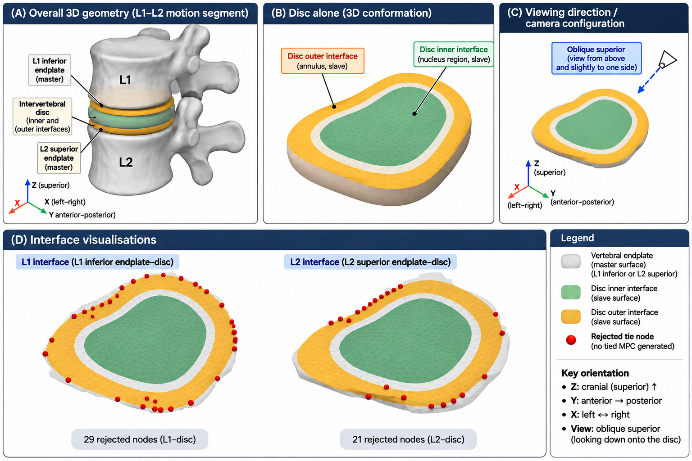
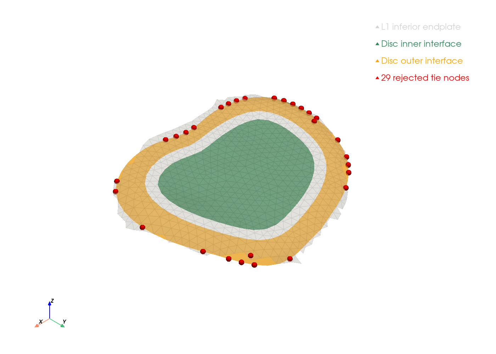
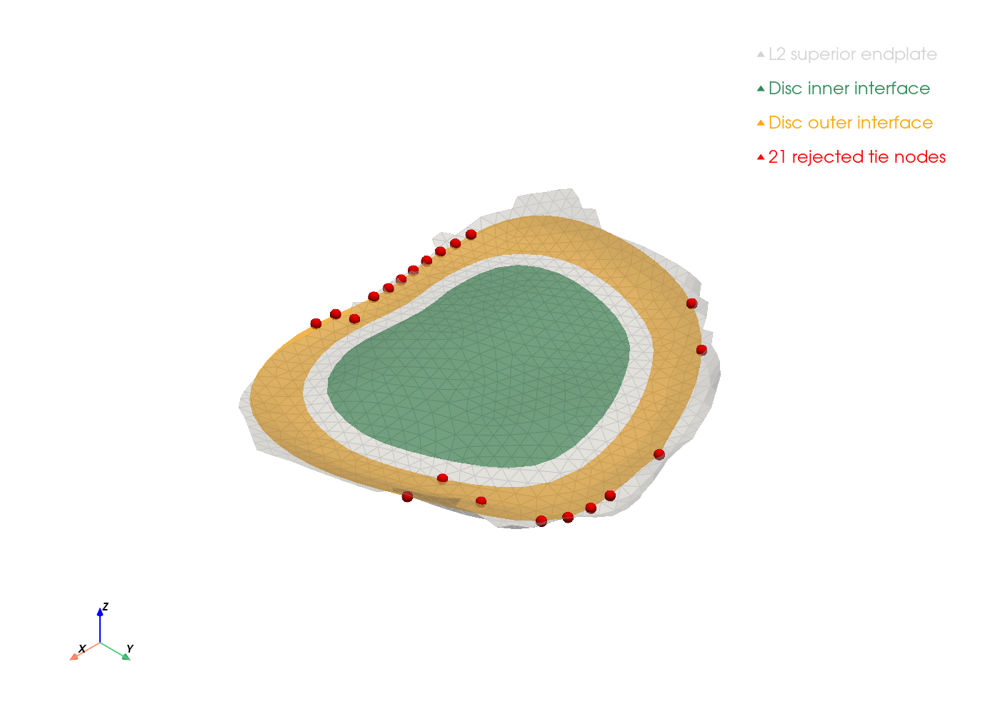

# Vertebra–Disc Interface Methodology

**Project:** L1–L2 Spinal Finite Element Analysis
**Status:** Interface investigation in progress
**Solver:** CalculiX 2.21

## 1. Purpose

This document records the investigation of vertebra–disc interface constraints in the baseline L1–L2 finite element model.

The objective is to establish mechanically appropriate load transfer between the vertebral bodies and intervertebral disc before interpreting stress distributions or attempting biomechanical validation.

## 2. Baseline model

The model comprises:

- L1 vertebral body
- L2 vertebral body
- Intervertebral disc
- 17,513 nodes
- 62,247 first-order tetrahedral elements

The L2 inferior surface is fixed in all translational directions.

A prescribed displacement of +0.1 mm along the Z-axis is applied to the L1 superior surface, producing compression.

The vertebrae and disc are connected using four CalculiX surface-based tie constraints.

## 3. Anatomical Orientation and Interface Geometry

The following schematic illustrates the anatomical relationship between the L1 and L2 vertebrae, the intervening disc, and the disc–vertebra interface surfaces used in the finite element model.

*Figure: Conceptual illustration of the L1–L2 motion segment and disc–vertebra interface geometry. The illustration is not a direct rendering of the computational mesh. The confirmed CalculiX results identified 29 rejected tie nodes at the L1 interface and 21 at the L2 interface. Actual interface geometry
and node locations are documented in the PyVista visualisations below.*

### 3.1 Computational Interface Visualisations

The following figures show the actual disc–vertebra interface surfaces reconstructed from the CalculiX tetrahedral mesh using PyVista.

Unlike the preceding anatomical schematic, these figures represent the computational geometry used in the simulations.

#### L1 Inferior Endplate–Disc Interface

*Figure 2. L1 inferior endplate (grey), inner disc interface (green), outer disc interface (orange), and 29 rejected tie nodes (red).*

#### L2 Superior Endplate–Disc Interface

*Figure 3. L2 superior endplate (grey), inner disc interface (green), outer disc interface (orange), and 21 rejected tie nodes (red).*

### 3.2 Preliminary Geometric Findings

Analysis of the CalculiX solver warnings identified 50 unique rejected tie nodes at a tolerance of 0.05 mm:

- L1 outer disc interface: 29 nodes.
- L2 outer disc interface: 21 nodes.
- Inner disc interfaces: 0 nodes.

The rejected nodes are predominantly located along the peripheral edges of the outer disc interfaces.

This distribution suggests that peripheral geometric mismatch may contribute to the failed tie constraints.

However, the visualisations do not independently establish whether the underlying cause is surface separation, peripheral overhang, mesh discretisation, or incorrect surface definitions.

Further quantitative geometric investigation is required before modifying the mesh.

### 3.3 Original MED Interface Topology

Inspection of the original MED mesh established that the disc interfaces were deliberately divided into inner and outer surface families.

Geometric analysis demonstrated that the inner interfaces form connected central patches with one closed boundary loop, whereas the outer interfaces form connected annular surfaces with two closed boundary loops.

The median radial distances of the inner surfaces were approximately 11–12 mm, compared with 20–21 mm for the outer surfaces.

All 50 nodes rejected by the 0.05 mm CalculiX tie constraints belong to these outer annular interface surfaces.

Three-dimensional visualisation demonstrated peripheral clustering. XY-projected footprint analysis identified 10 rejected nodes outside the corresponding vertebral endplate footprints and 40 within them.

These results support the interpretation that the remaining tie failures involve peripheral annular interface geometry.

However, the distinction between physiological peripheral disc extension and geometric mismatch remains unresolved. The original surface topology alone does not establish the appropriate mechanical attachment conditions.

The original geometry has therefore been preserved pending further mechanical verification and sensitivity analysis.

## 4. Identified interface problem

The original simulation used the automatically calculated tie tolerance of approximately 0.01206 mm.

Inspection of the solver warnings identified 228 unique disc nodes for which the intended tie constraints were not generated.

A second simulation increased the tie tolerance to 0.05 mm.

This reduced the number of untied disc nodes to 50, a reduction of approximately 78.1%.

However, the change also substantially altered the mechanical response.

## 5. Quantitative comparison

| Measurement | Original tolerance | 0.05 mm tolerance |
|---|---:|---:|
| Untied disc nodes | 228 | 50 |
| Axial reaction force | 397.320 N | 556.540 N |
| Effective axial stiffness | 3973.201 N/mm | 5565.400 N/mm |
| Maximum nodal displacement | 0.133626 mm | 0.132768 mm |
| Maximum nodal von Mises stress | 0.987775 MPa | 1.579123 MPa |

Increasing the tie tolerance produced:

- A 40.07% increase in effective axial stiffness.
- An approximately 59.9% increase in maximum nodal von Mises stress.
- A relatively small change in maximum nodal displacement.

Both simulations achieved negligible global axial force-equilibrium residuals.

## 6. Interpretation

The substantial change in axial stiffness indicates that the calculated mechanical response is sensitive to the interface constraint configuration.

Increasing the tie tolerance causes additional disc nodes to become mechanically constrained to the vertebral surfaces.

This changes the load-transfer pathways within the model.

The improved force balance and reduced number of untied nodes do not independently establish physiological accuracy.

The observed stiffness difference must therefore be treated as an interface sensitivity finding rather than evidence that either simulation is biomechanically validated.

## 7. Outstanding questions

1. Are the untied nodes caused by geometric gaps, nonconforming meshes or incorrectly defined surfaces?
2. Can the disc–endplate interfaces be made geometrically congruent without distorting the anatomy?
3. Would conforming shared-node meshes eliminate the need for surface-based tie constraints?
4. How much of the predicted stiffness is attributable to interface constraints versus material properties?
5. Does the use of first-order tetrahedral elements with a nearly incompressible disc introduce volumetric locking?
6. Are the peak stresses influenced by interface or mesh-related numerical artefacts?

## 8. Provisional modelling decision

Further increases in tie tolerance will not be used as the primary strategy for correcting the interface.

Geometric investigation has confirmed central and annular interface topology and identified peripheral regions of incomplete tie attachment. The next priority is to visualise displacement and stress fields, assess possible interface-related numerical artefacts, and determine whether targeted interface refinement is warranted.

The preferred approach will be selected after inspecting the existing mesh and considering published spinal finite element modelling methodologies.

This decision remains provisional pending further testing.

## 9. Validation limitations

The current model is exploratory.

It uses simplified homogeneous linear-elastic materials, first-order tetrahedral elements and idealised boundary conditions.

Mesh convergence, experimental calibration and physiological validation have not yet been established.

No clinical conclusions should be drawn from the current stress or stiffness predictions.

## 10. Supporting literature

The proposed interface investigation is informed by published lumbar finite element modelling studies:

- Ibarz et al. (2013): Geometrically congruent interfaces and tied connections between vertebrae and discs.
- Warren et al. (2020): Simplified lumbar modelling and computational efficiency.
- Wiczenbach et al. (2023): Shared-node connections and interface-specific contact formulations.
- Schmidt et al. (2007): Model calibration and validation.

These publications provide methodological context but do not validate our particular interface geometry, tie tolerance, material properties or stiffness predictions.

See [Literature References](references.md) for citations,
DOI links and study-specific limitations.
