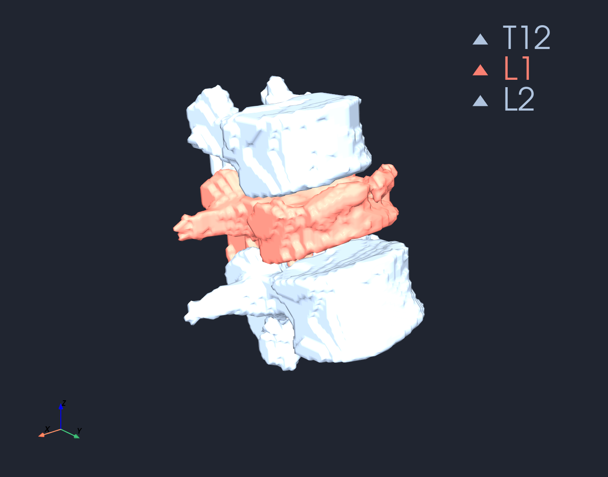
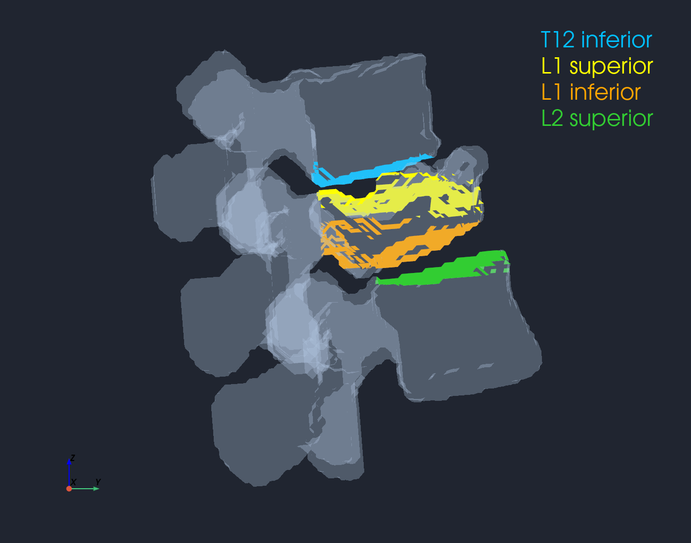
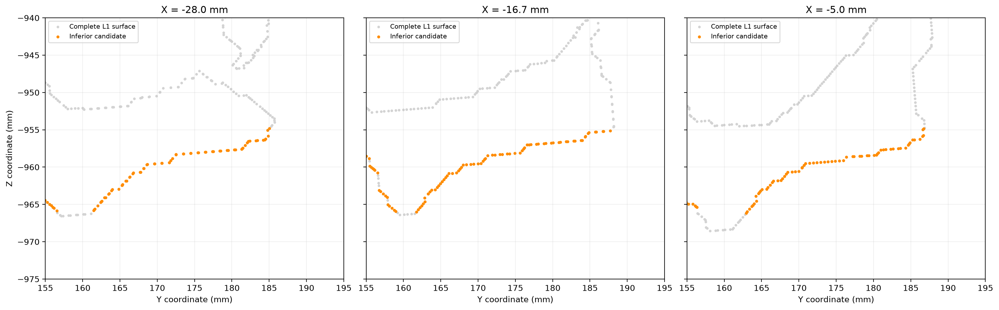
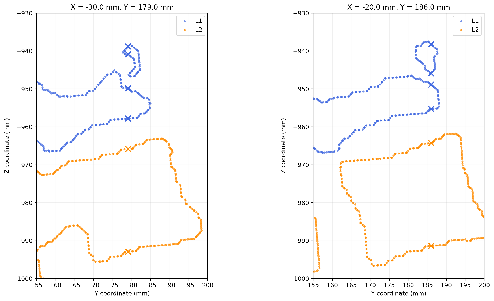
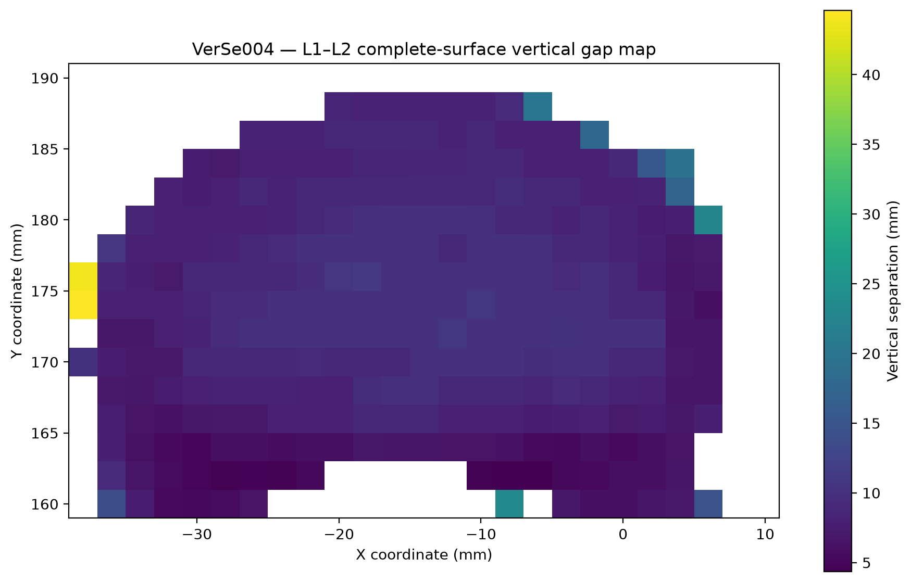
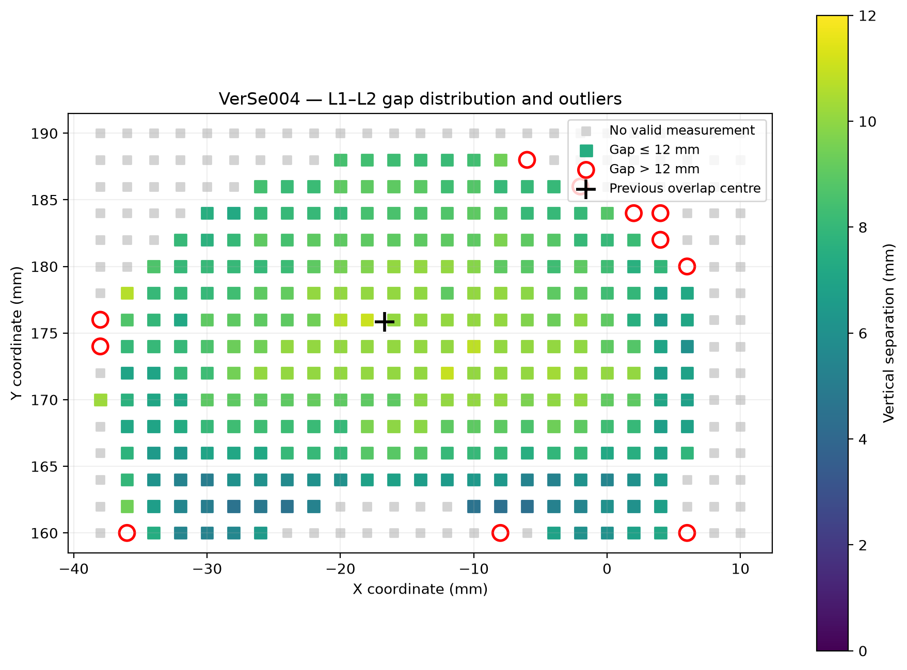
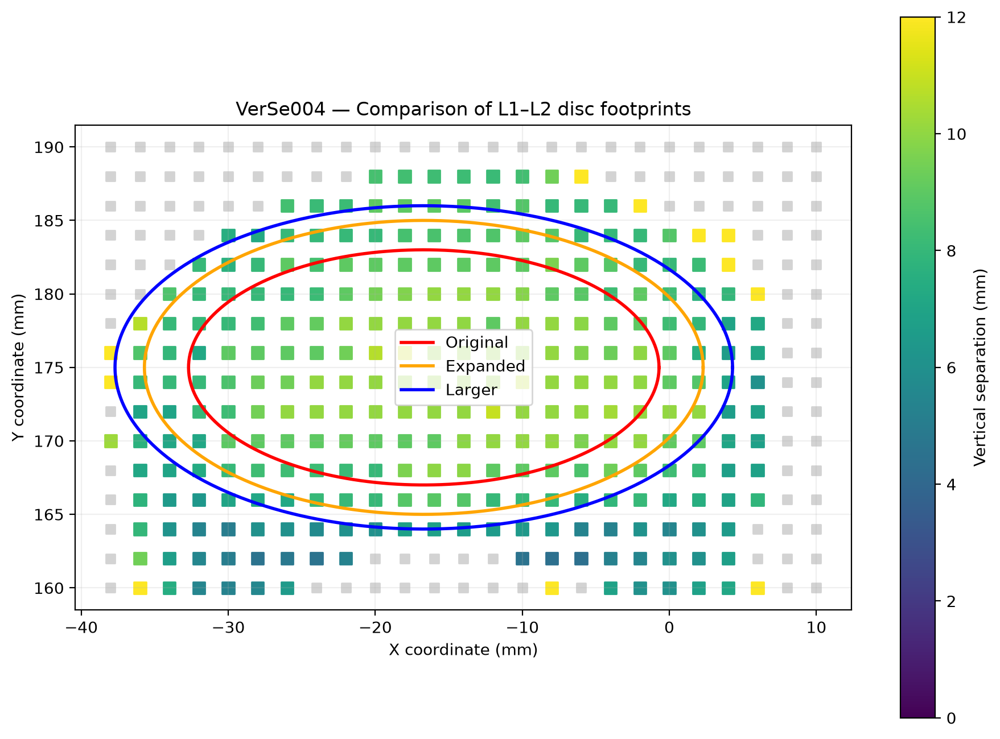

# VerSe004: Patient-Specific Vertebral Geometry Reconstruction and Disc-Space Investigation

**Project:** Spinal Finite Element Analysis (FEA)  
**Dataset:** VerSe 2019  
**Case:** `sub-verse004`  
**Anatomical region:** T12–L1–L2  
**Status:** Vertebral surface reconstruction completed; disc geometry reconstruction in progress

---

## 1. Objective

This investigation aims to reconstruct a patient-specific spinal geometry from CT imaging for subsequent finite element analysis of a vertebral compression fracture.

The selected VerSe004 case demonstrates L1 vertebral compression deformity. The intended computational model comprises T12, L1 and L2, together with idealised T12–L1 and L1–L2 intervertebral discs.

The immediate objectives are to:

1. Reconstruct the vertebral surfaces from CT segmentation data.
2. Identify the opposing vertebral endplates.
3. Characterise the intervertebral spaces.
4. Develop anatomically informed disc geometries.
5. Prepare the resulting geometry for volumetric meshing and mechanical simulation.

The investigation is exploratory. No patient-specific mechanical predictions have yet been obtained.

## 2. Dataset and Vertebral Reconstruction

### 2.1 Dataset selection

VerSe 2019 provides spinal CT imaging and vertebral segmentation annotations suitable for investigating three-dimensional vertebral anatomy.

The `sub-verse004` examination was selected after visual assessment identified an L1 compression deformity without obvious spinal instrumentation in the examined region.

The CT-derived geometry is used for anatomical reconstruction. The available vertebral segmentation does not directly provide a complete, patient-specific intervertebral disc segmentation.

Consequently, the discs must be reconstructed using geometric assumptions informed by the opposing vertebral surfaces.

### 2.2 Reconstructed surfaces

The T12, L1 and L2 vertebral surfaces were reconstructed and inspected using Python and PyVista.

| Vertebra | Surface triangles | Enclosed volume |
|---|---:|---:|
| T12 | 19,928 | 41,165.26 mm³ |
| L1 | 24,606 | 38,070.80 mm³ |
| L2 | 25,108 | 53,545.43 mm³ |

These volumes describe the reconstructed enclosed surfaces. They are not measurements of vertebral body volume alone, and the differences should not be interpreted as quantified fracture-related volume loss.

For this CT reconstruction, the positive Z direction corresponds to anatomical superior.

### 2.3 Anatomical alignment

*Figure 1. Reconstructed T12, L1 and L2 surfaces showing their relative anatomical alignment. This establishes the geometry for subsequent intervertebral disc reconstruction and patient-specific finite element modelling.*

## 3. Initial Endplate Identification

### 3.1 Surface-normal filtering

The first approach attempted to identify vertebral endplates by selecting surface triangles according to their normal orientations.

The intended selections were:

- T12 inferior endplate.
- L1 superior endplate.
- L1 inferior endplate.
- L2 superior endplate.

The initial candidate regions contained the following numbers of triangles:

| Candidate region | Triangles |
|---|---:|
| T12 inferior | 1,560 |
| L1 superior | 2,579 |
| L1 inferior | 2,554 |
| L2 superior | 1,573 |

*Figure 2. Candidate endplate regions obtained through surface-normal filtering. These patches provide an initial approximation but do not necessarily capture the entire anatomical endplate.*

### 3.2 Limitations of normal-based selection

Further inspection demonstrated that surface-normal filtering did not reliably identify all portions of the curved vertebral endplates.

In particular, the L1 inferior candidate omitted portions of the inferior vertebral body surface.

The revised L1 inferior candidate contained 2,512 triangles after removal of 42 lateral triangles. Subsequent connected-component analysis identified a principal region containing 1,809 triangles.

However, selecting the largest connected component did not resolve the underlying anatomical problem.

Some excluded regions appeared relevant to the inferior vertebral body contour.

*Figure 3. Comparison between the filtered inferior endplate selection and the complete reconstructed L1 surface. The discrepancy demonstrates that geometric filtering can exclude anatomically relevant curved regions.*

In selected sagittal locations, the inferior extent of the candidate patch differed from the complete L1 surface by approximately 0.41–2.39 mm.

These measurements were location-specific diagnostic comparisons, not a comprehensive assessment of endplate reconstruction error.

**Methodological decision:** The normal-filtered patches will not be used as definitive boundaries for disc reconstruction. Subsequent analysis will instead use the complete reconstructed vertebral surfaces, combined with anatomical restrictions to identify the relevant vertebral body regions.

## 4. Intervertebral Distance Investigation

### 4.1 Limitations of minimum surface distance

An initial challenge was determining the separation between opposing vertebral endplates.

Calculating the minimum distance between entire adjacent vertebral surfaces is insufficient because the closest structures may be posterior elements or facet joints rather than the opposing vertebral body endplates.

Consequently, a minimum whole-surface distance cannot be interpreted directly as intervertebral disc thickness.

This distinction is particularly important in pathological or degenerative spinal anatomy.

### 4.2 Vertical ray tracing

A subsequent approach used vertical rays to investigate intersections with the complete L1 and L2 surfaces.

For the L1–L2 space, the provisional method selected:

- The lowest relevant L1 intersection as the inferior L1 boundary.
- The highest relevant L2 intersection as the superior L2 boundary.

The difference in Z coordinates was used to estimate vertical separation.

This approach is computationally convenient but depends on correctly identifying intersections belonging to the opposing vertebral body surfaces.

### 4.3 Multiple intersections

Several rays intersected the same vertebral surface more than twice.

This occurs because a vertical ray may pass through multiple portions of complex three-dimensional anatomy.

*Figure 4. Diagnostic examination of multiple ray intersections with reconstructed vertebral surfaces. The presence of several intersections illustrates why a simple first-hit or last-hit rule requires anatomical verification.*

Two example locations were examined:

| X (mm) | Y (mm) | Estimated vertical gap |
|---:|---:|---:|
| −30 | 179 | 8.025 mm |
| −20 | 186 | 9.029 mm |

Visual examination suggested that the selected intersections at these locations corresponded to the intended vertebral body boundaries.

However, this does not establish that the selection method is reliable throughout the complete projected disc footprint.

**Methodological implication:** Ray-intersection results must be assessed in anatomical context. A geometrically valid intersection is not necessarily the correct endplate intersection.

## 5. Complete-Surface L1–L2 Gap Mapping

### 5.1 Sampling approach

The reconstructed L1 and L2 surfaces were sampled using vertical ray tracing across an axial grid.

The investigation covered approximately:

- X: −38 to 10 mm.
- Y: 160 to 190 mm.
- Sampling interval: 2 mm.

A total of 400 sampling locations were evaluated.

Of these, 286 produced valid positive gap measurements, representing 71.5% of sampled locations.

### 5.2 Preliminary measurements

| Measurement | Result |
|---|---:|
| Sampling locations | 400 |
| Valid positive gaps | 286 |
| Valid sampling proportion | 71.5% |
| Minimum estimated gap | 4.36 mm |
| Median estimated gap | 8.42 mm |
| Maximum estimated gap | 44.61 mm |

*Figure 5. Spatial distribution of positive vertical separation measurements obtained from the complete reconstructed L1 and L2 surfaces. Values represent geometric ray-based estimates rather than validated anatomical disc thickness.*

### 5.3 Outlier investigation

Some estimated gaps were implausibly large for an intervertebral disc space.

The largest recorded value was approximately 44.61 mm.

These extreme values occurred near the margins of the investigated region and were considered likely consequences of unintended surface intersections or sampling outside the anatomically appropriate disc-contact region.

*Figure 6. Spatial locations of unusually large gap estimates. Their distribution supports the need for anatomical footprint restrictions and intersection validation before constructing a disc volume.*

The observed outliers do not establish pathological disc enlargement.

They instead demonstrate limitations of unrestricted ray tracing over complex vertebral surfaces.

### 5.4 Interpretation

The median estimated separation of 8.42 mm provides a preliminary description of the sampled geometric space.

However, it must not be treated as a validated measurement of patient-specific disc height.

The current estimates are influenced by:

- Sampling location and grid resolution.
- Anatomical coverage of the projected vertebral body surfaces.
- Selection of ray intersections.
- Vertebral endplate curvature.
- Possible posterior-element intersections.
- Degenerative or pathological vertebral morphology.

These factors require further investigation before the gap map can be used to define a mechanically connected disc geometry.

## 6. Disc Footprint Investigation

### 6.1 Initial elliptical approximation

The first proposed disc footprints were simple ellipses.

This provided a convenient geometric starting point but was not intended to represent the final patient-specific anatomy.

Several elliptical dimensions were compared:

| Approximation | Width | Depth |
|---|---:|---:|
| Initial | 32 mm | 16 mm |
| Expanded | 38 mm | 20 mm |
| Larger | 42 mm | 22 mm |

*Figure 7. Comparison of provisional elliptical disc footprints relative to the reconstructed vertebral anatomy. These comparisons were used to assess the limitations of a simple geometric approximation.*

Visual assessment suggested that even the larger ellipse might inadequately represent the anatomical disc footprint.

In addition, an ellipse does not naturally reproduce the characteristic irregular, kidney-shaped axial outline of a lumbar intervertebral disc.

### 6.2 Revised modelling strategy

The planned approach is to derive the disc footprint from the projected contours of the opposing vertebral body endplates.

The proposed reconstruction will:

1. Identify the anatomically relevant opposing vertebral body surfaces.
2. Extract and compare their projected axial contours.
3. Construct a smoothed, anatomically informed disc footprint.
4. Introduce a modest circumferential annular bulge as an explicit modelling assumption.
5. Generate superior and inferior disc boundaries that conform to the selected vertebral endplate surfaces.
6. Check for geometric intersections, gaps and non-manifold surfaces.
7. Generate a volumetric mesh suitable for finite element analysis.

The planned bulge is an idealisation intended to represent plausible disc morphology. It is not evidence of a measured patient-specific annular bulge or focal disc protrusion.

Where the disc extends beyond the vertebral endplate, the peripheral region must not be artificially tied to unsupported bone surfaces.

The same general approach is intended for the T12–L1 disc after evaluation of the L1–L2 reconstruction.

## 7. Key Troubleshooting Findings

| Challenge | Finding | Consequence for modelling |
|---|---|---|
| Minimum whole-surface distance | May identify facet or posterior-element proximity | Restrict measurements to opposing vertebral body regions |
| Surface-normal filtering | Excluded portions of curved endplates | Use complete surfaces with anatomical restrictions |
| Connected-component filtering | Could remove relevant anatomical regions | Do not assume the largest component is anatomically complete |
| Vertical ray tracing | Produced multiple intersections | Validate selected intersections against vertebral body anatomy |
| Unrestricted gap mapping | Produced implausible outliers | Apply anatomical footprint constraints and outlier checks |
| Elliptical disc approximation | Inadequately represented the projected anatomy | Develop a CT-derived, smoothed kidney-shaped footprint |
| Peripheral disc geometry | May extend beyond supporting bone | Avoid artificial bone–disc constraints outside the true interface |

These investigations demonstrate the importance of anatomical interpretation during computational geometry development.

Numerically successful calculations are not necessarily anatomically meaningful.

## 8. Reproducibility and Data Availability

The reconstruction script is available at:

[`scripts/reconstruct_verse004_adjacent.py`](../scripts/reconstruct_verse004_adjacent.py)

Selected diagnostic figures are available in:

[`outputs/figures/`](../outputs/figures/)

The original CT imaging, segmentation files, reconstructed surface meshes and intermediate numerical arrays are retained locally and are not redistributed through this repository.

Some exploratory gap calculations and diagnostic visualisations were performed through interactive terminal scripts. Their complete generation workflows have not yet been consolidated into reproducible standalone scripts.

Therefore, the repository currently documents the investigation and its principal outputs but does not provide complete end-to-end reproducibility of every geometric measurement.

A future improvement will be to consolidate these calculations into version-controlled Python scripts with explicit input parameters and quality-control checks.

## 9. Limitations

This investigation has several important limitations.

**Anatomical limitations:** The available segmentation identifies vertebral structures but does not provide a complete patient-specific disc segmentation. Disc morphology must therefore be approximated.

**Geometric limitations:** Surface-normal filtering, connected-component selection and ray tracing are sensitive to complex vertebral geometry. Some measurements may involve unintended intersections.

**Sampling limitations:** The preliminary gap map uses a finite spatial sampling grid and does not represent a complete continuous measurement of disc-space geometry.

**Biomechanical limitations:** No patient-specific material properties, volumetric disc mesh, validated contact formulation or mechanical simulation have yet been established for VerSe004.

**Clinical limitations:** The reconstructed geometry and future FEA results must not be interpreted as validated predictions of fracture progression, spinal instability or treatment requirements.

## 10. Next Steps

The immediate priority is to construct the L1–L2 intervertebral disc geometry using anatomically informed endplate contours.

The next tasks are:

1. Delineate the projected vertebral body footprints from the complete CT-derived surfaces.
2. Derive a smoothed kidney-shaped disc outline.
3. Assess the relationship between the proposed disc boundary and the opposing endplate surfaces.
4. Introduce a modest circumferential bulge while preserving realistic contact boundaries.
5. Generate and inspect the three-dimensional disc volume.
6. Extend the reconstruction to T12–L1.
7. Prepare the vertebra–disc assembly for volumetric meshing and exploratory finite element analysis.

Mechanical simulation will follow only after the reconstructed geometry has undergone appropriate geometric quality checks.

---

## Summary

The VerSe004 investigation has progressed from CT-derived vertebral reconstruction to detailed assessment of endplate geometry and intervertebral spacing.

The principal methodological finding is that simple geometric approaches—including surface-normal filtering, unrestricted minimum-distance calculations and vertical ray tracing—can produce anatomically incomplete or misleading results.

These observations motivated a revised approach based on complete vertebral surfaces, anatomically restricted endplate regions and CT-informed disc footprints.

The patient-specific finite element model remains under development. Its eventual mechanical results will require numerical verification and appropriate validation before any biomechanical interpretation.
